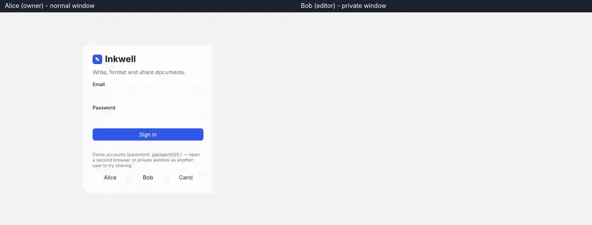
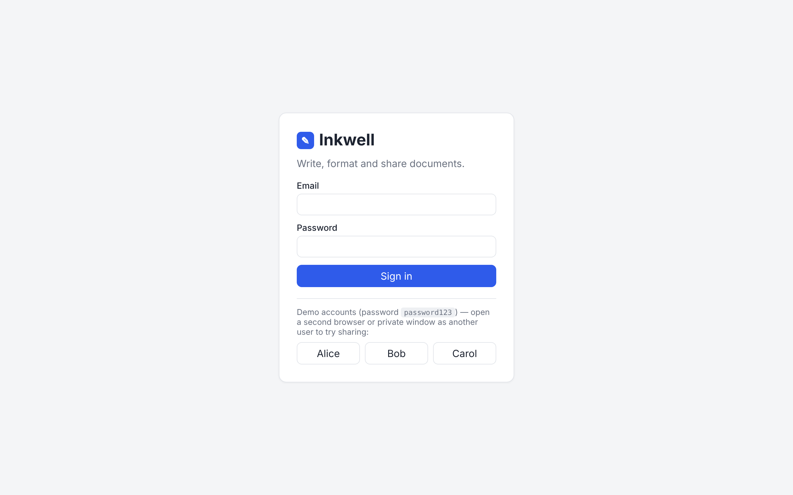
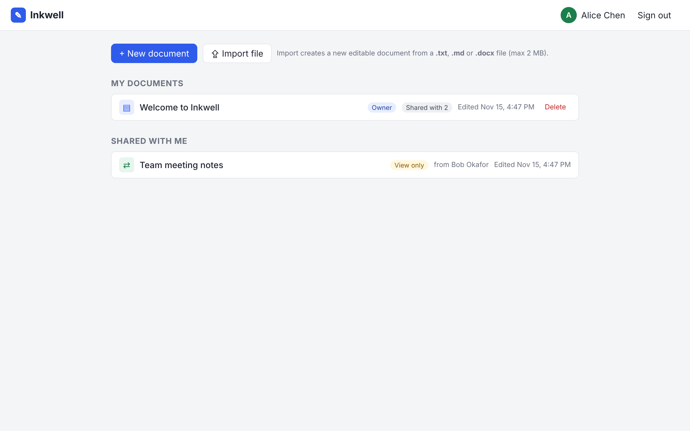
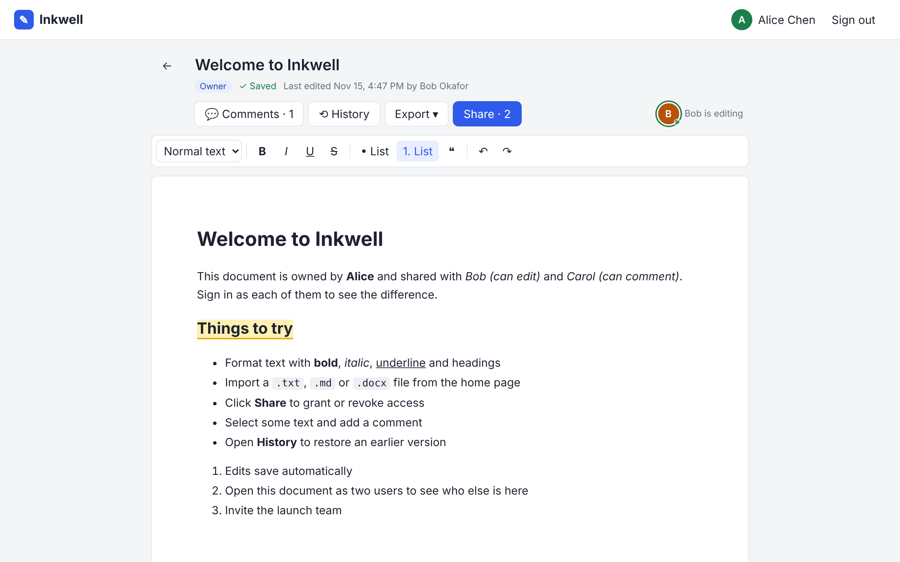
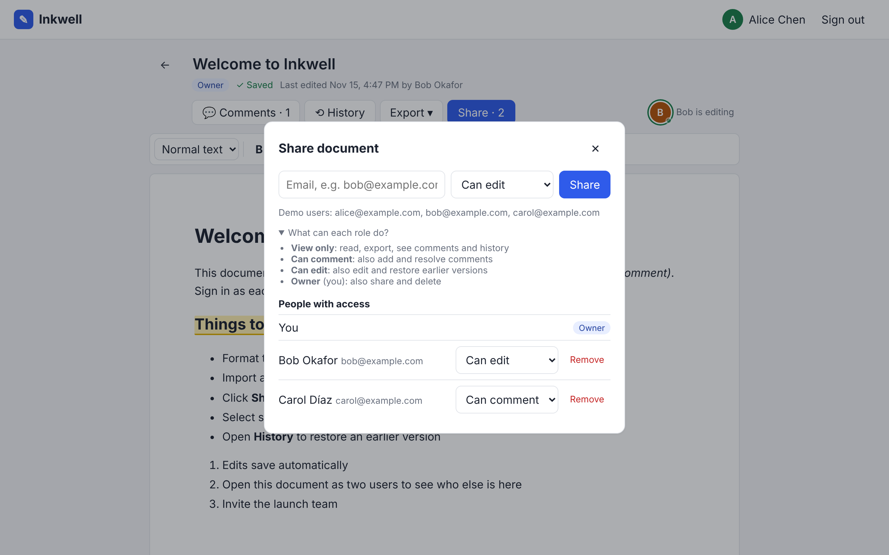
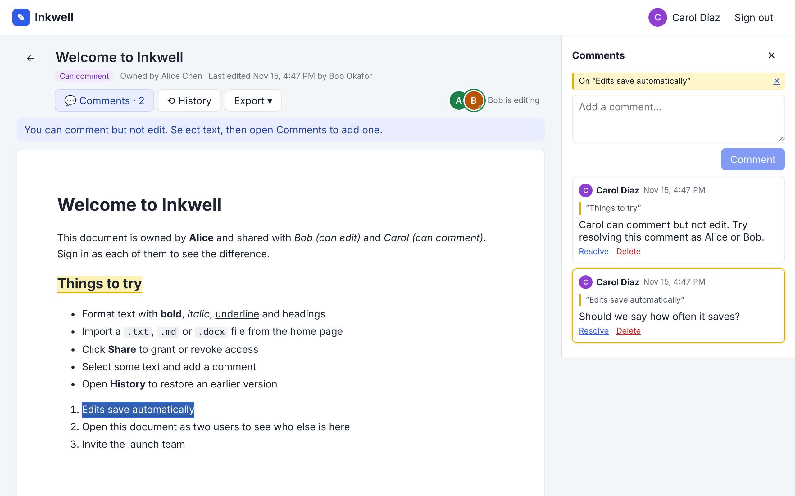
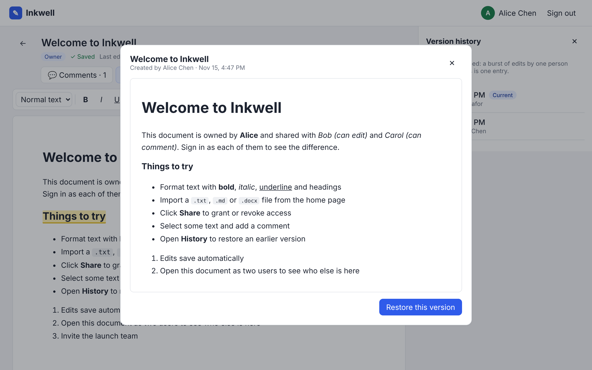
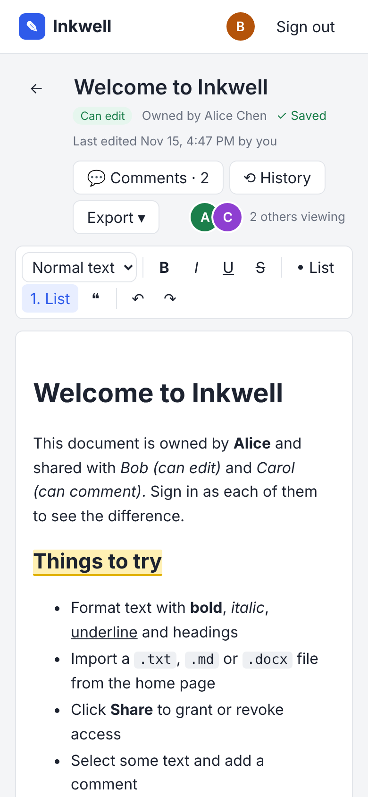

# Inkwell

A small full-stack document editor: create and format documents in the browser, import `.txt` / `.md` / `.docx` files, share documents as **viewer**, **commenter** or **editor**, comment on selected text, see who else is in the document, browse and restore version history, and export to Markdown or PDF.

**Stack:** React 18 + Tiptap (ProseMirror) · Node 22 + Express 5 · SQLite via libSQL (local file in development, [Turso](https://turso.tech) in production) · Vitest + Supertest

**Live demo:** https://inkwell-8o3b.onrender.com: sign in with any [demo account](#demo-accounts) (password `password123`). It runs on Render's free plan, so the first visit after a quiet period can take up to a minute to wake up.

**Walkthrough video:** https://www.loom.com/share/da198bc45d3c4b2bafa70a7f33ccdd90

**What's in this submission:** see [SUBMISSION.md](SUBMISSION.md).



## Features

| Requirement | What's implemented |
|---|---|
| Documents | Create, rename (click the title), edit, delete (owner only). Autosave ~0.8 s after typing stops; **Ctrl/Cmd+S** saves immediately. A status shows *Unsaved changes / Saving… / ✓ Saved / Save failed (Retry)*. The browser warns before closing a tab with unsaved changes. |
| Rich text | Bold, italic, underline, strikethrough, Heading 1–3, bulleted & numbered lists, block quotes, undo/redo, plus standard keyboard shortcuts. |
| File upload | **Import file** turns an uploaded file into a new editable document. **Supported: `.txt`, `.md`, `.docx`, max 2 MB.** Other types are rejected with a clear message (checked in the browser *and* on the server). The document title comes from the file name; Word/Markdown headings, bold/italic and lists are kept. Images and tables in `.docx` are dropped (the editor doesn't support them). |
| Sharing | Every document has one **owner**. The owner can share by email as *View only*, *Can comment* or *Can edit*, change the access level, or remove access. The home page separates **My documents** from **Shared with me** (with owner name and access badge). Viewers and commenters get a read-only editor with no toolbar; the server enforces every rule, not just the UI. |
| Persistence | SQLite-compatible storage: a local file in development, a hosted Turso database in production. Content is stored as sanitized HTML, so formatting round-trips exactly. Documents, shares and login sessions survive refreshes, server restarts and redeploys. |
| Concurrent edits | Each document has a version number. A save based on an outdated version is rejected (`409`) and the editor shows a "someone else saved this — reload" banner instead of silently overwriting the other person's work. |

### Enhancements

| Enhancement | What's implemented |
|---|---|
| **Real-time collaboration indicators** | Avatars of everyone else who has the document open, with a green ring and dot for anyone typing, and a summary like "Bob is editing". The header shows who made the last edit. When someone else saves and you have no unsaved changes, their version loads into your editor automatically (no reload; your cursor is kept; it isn't added to your undo history), with a short notice. |
| **Commenting** | Select text, then open **Comments** to comment on it. The quoted text is highlighted in the document; clicking a highlight opens its comment. Comments can be resolved, reopened, and deleted by their author or the document owner. New comments from others appear within a few seconds. |
| **Version history** | **History** lists saved versions, newest first, with author and time. A burst of autosaves by one person within 5 minutes is grouped into one entry, so the list stays readable. Created, imported and restored versions are always their own entries. Click any entry to preview it, and editors can **restore** it. A restore is itself a new entry, so it can be undone. |
| **Export** | **Export → Markdown** downloads a `.md` file converted on the server (headings, bold, italic, lists, quotes, strikethrough; underline is kept as `<u>`, which Markdown lacks). **Export → PDF** opens the browser's print dialog with a print layout of just the title and content; choose "Save as PDF". |
| **Role-based permissions** | Roles form a ladder; each can do everything the one before it can. **View only**: read, export, see comments and history. **Can comment**: also add and resolve comments. **Can edit**: also edit and restore versions. **Owner**: also share and delete. |

## Demo accounts

Auth is a lightweight email + password login with seeded users (all use password **`password123`**). The login page has one-click buttons for each.

| User | Email |
|---|---|
| Alice Chen | alice@example.com |
| Bob Okafor | bob@example.com |
| Carol Díaz | carol@example.com |

A brand-new database is also seeded with three documents so sharing is visible immediately:

| Document | Owner | Shared with |
|---|---|---|
| Welcome to Inkwell | Alice | Bob (can edit), Carol (can comment); includes a comment from Carol |
| Team meeting notes | Bob | Alice (view only) |
| Carol's private draft | Carol | nobody |

**To try sharing yourself:** sign in as Alice in one window and Bob in a private/incognito window (sessions are per-browser cookies). Alice creates a doc → **Share** → `bob@example.com`. Bob's home page now lists it under *Shared with me*.

## Screenshots

Trying sharing yourself takes one extra step: each user needs their own browser session, e.g. Alice in a normal window and Bob in a private window. These show what to expect.

| | |
|---|---|
|  |  |
| **Login:** one-click demo accounts | **Home:** owned vs shared, with access level |
|  |  |
| **Editor:** formatting toolbar, "Bob is editing", highlighted comment | **Sharing:** view, comment or edit |
|  |  |
| **Commenter:** read-only editor, comments on selected text | **History:** preview and restore an earlier version |



**Phone:** the editor at 390 px wide.

## Run locally

Requires **Node.js 20.6+** (22 recommended). No database to install: locally the app uses a SQLite file.

```bash
npm install
npm run dev        # API on :3000 + Vite dev server on http://localhost:5173 (proxies /api)
```

Production-style run (one process serves the API and the built client):

```bash
npm run build
npm start          # http://localhost:3000
```

Environment variables:

| Variable | Default | Purpose |
|---|---|---|
| `PORT` | `3000` | HTTP port |
| `TURSO_DATABASE_URL` | unset | Hosted Turso database, e.g. `libsql://inkwell-you.aws-us-west-2.turso.io`. When set, it takes priority. |
| `TURSO_AUTH_TOKEN` | unset | Token for that database |
| `DATABASE_PATH` | `./data/docs.db` | Local SQLite file, used when no Turso URL is set. Created on first start, with demo users and documents seeded. |

The Docker image refuses to start with neither a Turso URL nor `DATABASE_PATH`. This stops a free host's temporary disk from silently losing data.

To reset all data, stop the server and delete `data/docs.db`.

## Tests

```bash
npm test           # 29 API integration tests (Vitest + Supertest, in-memory SQLite)
npm run typecheck  # tsc over server and client
```

The tests drive the real Express app over HTTP and cover: auth required / bad credentials; create → rename → edit → reopen with formatting preserved; HTML sanitization (scripts and event handlers stripped); stale-write rejection (409); input validation; **the full owner / editor / viewer permission matrix** (including that non-shared users get 404 and that revoking access works); sharing edge cases; and importing `.md`, `.txt` and a real `.docx` fixture, plus rejection of unsupported, missing, corrupt and oversized files.

`server/features.test.ts` covers the enhancements: upgrading a database created with the original schema without losing data, the commenter role's permissions, comment create/resolve/delete rules, history grouping (by author and by time) and restore (including conflicts), the exact Markdown output, and presence (heartbeats, the editing flag, expiry and leaving), using an injected clock.

## Deploy (free): Render + Turso

The app runs on **Render's free plan**, and the data lives in a **free Turso database**. Render's free plan has no persistent disk, so the database has to live elsewhere. Turso speaks SQLite, so the same schema and queries run locally and in production.

### 1. Create the Turso database (about 2 minutes)

Sign up at [turso.tech](https://turso.tech). Then either use the web dashboard (*Create database*, location **AWS US West (Oregon)**, then *Create token*) or the CLI:

```bash
curl -sSfL https://get.tur.so/install.sh | bash
```

```bash
turso auth login
```

```bash
turso db create inkwell
```

```bash
turso db show inkwell --url
```

```bash
turso db tokens create inkwell
```

Pick a US West (Oregon) location if you're asked, to sit next to the Render service; any region works, just with a little more latency. Copy the URL (`libsql://…`) and the token. The app creates its tables and demo data on first start, so you don't need to run any SQL.

### 2. Deploy on Render (about 3 minutes)

1. Sign in at [render.com](https://render.com) with GitHub.
2. Choose **New → Blueprint** and select this repository. Render reads [`render.yaml`](render.yaml): a free Docker web service in Oregon with a health check on `/api/health`.
3. Render asks for `TURSO_DATABASE_URL` and `TURSO_AUTH_TOKEN`. Paste the values from step 1.
4. Click **Deploy**. The first build takes a few minutes. Open the `https://inkwell-xxxx.onrender.com` URL and sign in with a demo account. Signing in reads from Turso, so it also confirms the database connection works. If the deploy fails, check the Render logs: a wrong URL or token shows up there at startup.

Without the Blueprint: **New → Web Service** → this repo → Runtime **Docker**, Instance type **Free**, and add the two environment variables.

**Free-plan caveats:** Render puts the service to sleep after 15 minutes without traffic, and the next request takes up to about a minute to wake it. Open the URL once before sending it to a reviewer. Data is unaffected, because it's in Turso.

### Other hosts

Any Docker host works. With Turso, pass the two variables. Without Turso, mount a volume:

```bash
docker build -t inkwell .
```

```bash
docker run -p 3000:3000 -e DATABASE_PATH=/data/docs.db -v inkwell-data:/data inkwell
```

## Project layout

```
server/
  app.ts           Express app: routes, validation (zod), error handling
  permissions.ts   role ladder and access checks (404 for no access, 403 for insufficient role)
  documents.ts     create/delete documents, version history (grouping, milestones)
  presence.ts      who has a document open (in-memory heartbeats)
  exporters.ts     HTML → Markdown
  content.ts       HTML sanitization + .txt/.md/.docx → HTML conversion
  db.ts            migrations, Turso/local config, query helpers
  seed.ts          demo documents for an empty database
  auth.ts, passwords.ts, http.ts
  index.ts         entry point
  *.test.ts        API integration tests
  fixtures/        sample.docx used by the tests
client/src/
  Editor.tsx            editor page: autosave pipeline, conflicts, presence heartbeat, live updates
  commentHighlights.ts  ProseMirror plugin that highlights commented text
  CommentsPanel.tsx, HistoryPanel.tsx, Presence.tsx, Toolbar.tsx, ShareDialog.tsx
  DocList.tsx           home page: owned vs shared, create, import
  api.ts                typed fetch wrapper, role helpers
```

See [ARCHITECTURE.md](ARCHITECTURE.md) for design decisions and [AI_WORKFLOW.md](AI_WORKFLOW.md) for how AI was used.
